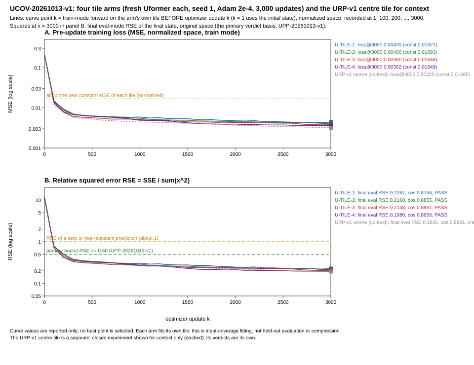

# UCOV-20261013-v1 result: the Uformer on four more tiles of the same real snapshot

## Primary decision (UPP-20261013-v1): the coverage criterion is MET, with all four arms passing

Every registered arm completed validly and passed the primary policy: P = 4, F = 0, U = 0, against the pre-specified
rule "P ≥ 3: met". Each arm trained a fresh frozen Uformer, with the same seed and initial state, on its own 32 × 32
tile. Each final reconstruction in eval mode, in the original space, has:
- RSE ≤ 0.50;
- cosine ≥ 0.65;
- MSE ≤ 0.80 × the best constant baseline.

The single-tile fitting level observed for the URP-v1 centre tile therefore held for these four fixed tiles of the
same snapshot. That statement is limited: one seed per arm, one snapshot, an expanded latent and no held-out data
(see Limits).

The implementer wrote this report; it is not an independent acceptance.

## Identity and execution

- **Package.** `manifest_ucov.json`, SHA-256 `3bc2ab302f6cd77b63b9bb8b77894041fd97cbdd63d5fa7f380a4dae080fe824`
  (17,562 bytes).
  - It lists 65 files plus 5 external files bound by hash.
  - It was frozen at 2026-10-13 21:18:48 +08:00 and matched in full before the launch and again after the run.
- **Authorization.** The user approved the design before the manifest existed. No prior approval of this digest is
  claimed (`EXECUTION_AUTHORIZATION.md`).
- **Primary policy.** UPP-20261013-v1: `upp_policy.json` `74b277b952e0af68dee00692cde6b95f8ed747d641843bbe98517c70d98c5770`
  and `upp_classify.py` `31904623…ecbb1`.
  - These identities appear in the resolved configuration, the invocation record, every job file, every child
    record and the analysis.
  - The UID `criteria` (0.01 / 0.99) were not read for the primary verdict.
- **Run.** One invocation, with 4 of 4 starts. The scientific command ran from 21:23:00.267 to 21:56:08.046 +08:00
  (wall clock 1,987.8 s) and exited 0; the supervisor aggregate was 1,987.265 s, within its 9,000 s limit.
  - The arms ran one after another in registered order. Each ended before the next started.
  - Each arm made 3,000 of its 3,000 updates.
  - There was no guard action, no interruption and no global stop, and every stderr was empty.
  - **The budget is consumed:** 1 of 1 invocation, 4 of 4 starts.
- **Inputs.**
  - The four tiles come from the rule registered at 20:23:39.610 +08:00, before the payload was opened at 20:37:23.
  - They were rebuilt from the archived R3 snapshot, t 7, client 91: the Phi hash `485cbe5f…2546` equals the archived
    value, and so does its SIG.
  - All four are usable, and none was replaced or reordered.
  - Their tensor hashes and both baselines were re-checked inside each child before the optimizer existed.

## Per-arm results (final eval mode, original space unless stated)

| Arm | Slice | RSE | Cosine | MSE | Zero-pred. MSE | Scalar-mean MSE | MSE / best | Improvement | Primary | Strict 0.01/0.99 | EP-v1 |
|---|---|---|---|---|---|---|---|---|---|---|---|
| U-TILE-1 | `[512:544, 384:416]`, L6 | 0.22669 | 0.87940 | 1.08135e-06 | 4.77014e-06 | 4.76505e-06 | 0.22693 | 77.3% | **PASS** | FAIL | PASS |
| U-TILE-2 | `[512:544, 1152:1184]`, L18 | 0.21596 | 0.88546 | 1.01559e-06 | 4.70266e-06 | 4.69702e-06 | 0.21622 | 78.4% | **PASS** | FAIL | PASS |
| U-TILE-3 | `[1536:1568, 384:416]`, L6 | 0.21478 | 0.88613 | 9.84709e-07 | 4.58473e-06 | 4.58456e-06 | 0.21479 | 78.5% | **PASS** | FAIL | PASS |
| U-TILE-4 | `[1536:1568, 1152:1184]`, L18 | 0.19796 | 0.89557 | 9.08149e-07 | 4.58759e-06 | 4.58709e-06 | 0.19798 | 80.2% | **PASS** | FAIL | PASS |

How to read the table:
- **Full precision.** Full-precision values are in `analysis/analysis.json` and `independent_verification.json`.
- **Columns.**
  - "Best" is the scalar-mean baseline in every arm; the scalar mean predicts one scalar across the tile.
  - "Improvement" is 1 − MSE / best.
  - The baselines equal the registered values exactly, in the child and in the analysis. An independent recomputation
    from the tile bytes with `math.fsum` agrees to within 1 ulp; that is summation order, not a discrepancy.
- **Margins.** Every arm clears each primary bound by a wide margin: RSE by at least 0.273, cosine by at least 0.229,
  and the baseline condition with MSE/best ≤ 0.227, against 0.80.
- **Secondary references.** These are reported only and cannot veto the primary verdict.
  - The historical strict near-identity criterion fails in all four arms: RSE is 19.8 to 22.7 times the bound.
  - EP-20261012-v1 passes in all four arms.
- **Train mode** (reported only): RSE 0.2238, 0.2140, 0.2055 and 0.1953; cosine 0.8810, 0.8866, 0.8914 and 0.8971.
  The train-minus-eval output SSE is 0.9% to 4.1% of the eval SSE (normalized space), so the BatchNorm mode switch
  accounts for little of the remaining error. That neither proves nor rules out a BatchNorm-related mechanism.
- **Step 0** (eval mode, the initial state): RSE 1.031 to 1.060, so the improvement came from training.
- **Context only, not a fifth arm.** The URP-v1 centre tile, a separate closed experiment, reached RSE 0.1935 and
  cosine 0.8981. Its recorded verdicts are unchanged: strict COMPLETED_FIT_FAIL and pre-specified EP-v1 PASS.
  Applying UPP-v1 to it would be retrospective and would give PASS.

## Learning curves ([learning_curves_ucov.svg](learning_curves_ucov.svg), [curves_ucov.csv](curves_ucov.csv))

- **Timing.** Point k is the train-mode forward on the arm's own tile before update k, in normalized space; point 1
  uses the initial state. The verdict is never read from the curve.
- **Shape.** All 124 points are finite, every parameter got a finite gradient at every point, and every element
  moved.
  - The loss fell from 0.203–0.213 to 0.00362–0.00439. The best constant's loss is about 0.0185–0.0192.
  - Unlike URP-v1's curve, the loss was not monotone at the recorded points: 2 to 6 small rises per arm, the largest
    3.4%, in U-TILE-1.
  - Over the last 1,000 updates the loss fell by a further 7.4%, 9.4%, 11.0% and 7.8%, and it was still falling
    slowly. The point at 3,000 is not the minimum in U-TILE-1 or U-TILE-3, where 2,900 is lower. The final state is
    used as registered.
- **Parameters.** They moved 3.2% to 5.8% from their initial values, as relative L2 per group, similar to URP-v1.

## Verification

- **Frozen analyzer** (`ucov_analyze.py`, exit 0, 21:57:11–21:57:12): every arm's evidence verified with no
  problems, and the child's verdict equals the analyzer's.
  - `analysis/analysis.json` is 40,080 bytes, SHA-256 `ed717404ead2a6fe158634ceda2f78f81ee2204936f4413471bdf60345f0ce6d`.
  - The sealed list covers 48 files, every file in the run root and the mirror.
- **`independent_verify.py`** imports neither torch nor the analyzer, and all of its checks hold.
  - Integrity after the run: 65/65 entries and 5/5 externals; the mirror is byte-identical to the primary ledger.
  - Tile hashes were recomputed from the bytes.
  - Metrics recomputed from the recorded SSE, T, P, D and N equal the records, with exact rationals agreeing to 0 ulp.
  - The policy re-implemented from `POLICY.md`, the pinned classifier, the child and the analyzer all agree on every
    arm and on the aggregate.
  - The state files were parsed without torch: hashes, 296 tensors, `num_batches_tracked` 0 then 3,000, finite
    values, and unchanged index buffers. The four initial states are identical.
- **Forward-only replay** (`replay_final_states.py`, 21:59:24–21:59:29): for each arm, separate fresh models were
  loaded for eval and train mode, with no optimizer.
  - Every recorded sum is bit-identical in both modes and both spaces.
  - The eval copy was unchanged; the disposable train copy's BatchNorm buffers changed, as recorded.
  - The run-root files are unchanged.

## Resources

| Arm | Arm wall s (limit 1,800) | Child process s | Training loop s (s/update) | Guard sampled max RSS | OS peak working set |
|---|---|---|---|---|---|
| U-TILE-1 | 491.890 | 489.422 | 486.563 (0.162) | 829,927,424 B | 830,124,032 B |
| U-TILE-2 | 497.578 | 495.344 | 492.531 (0.164) | 823,713,792 B | 827,572,224 B |
| U-TILE-3 | 499.000 | 496.547 | 493.547 (0.165) | 827,088,896 B | 827,088,896 B |
| U-TILE-4 | 498.313 | 495.859 | 493.078 (0.164) | 830,214,144 B | 830,541,824 B |

- **Limits.** The RSS limit was 4,294,967,296 B. Retained evidence was 25,669,235 B, against a cap of 536,870,912 B.
- **Timing scopes.**
  - The supervisor aggregate, 1,987.265 s against a limit of 9,000, runs from the supervisor's import to its summary.
  - The launch wrapper, from status-before to status-after, took 21:22:56.533–21:56:11.350.
  - The arm wall time runs from just before its start record to the child's exit.
- **Load.** Background load was not controlled.

## Limits of interpretation

- **What is shown.** A fresh model fit each of five fixed tiles clearly better than any constant: the four arms here,
  plus the URP-v1 tile as context.
  - All five tiles are q/k blocks of one snapshot.
  - Each tile is evaluated on itself.
- **Not shown:**
  - compression: the latent is a 64:1 expansion;
  - held-out generalization;
  - reconstruction of the whole snapshot, of the v/o blocks or of other snapshots;
  - near-identity reconstruction;
  - seed stability or significance: one seed and one start per arm;
  - superiority of any architecture, downstream utility or FAF success.
- **Policy disclosure.** The primary policy was chosen with knowledge of the URP-v1 result. It was pre-specified for
  this study, which is where it is applied prospectively.
- **Tile spread.** The four tiles were registered by position before their values were read. Their RSE spread is
  small (0.198 to 0.227), but four tiles do not estimate the distribution over the 3,072 tiles of the snapshot.

## Discrepancies and deviations

- **Scientific evidence: none found.**
- **Engineering.**
  - The console copy of the first `independent_verify.py --write` run was lost to a PowerShell argument error in the
    calling command. The record itself was written; the run exited 0, and the printed hash
    `1894ca82…8240` matches the file. `independent_verify.out.txt` holds a print-only re-run and says so.
  - During development, before the freeze, two analysis tests and one lifecycle test exposed test or fixture bugs;
    they were fixed. The frozen pre-freeze check run, `evidence/final1_20261013`, has all 9 steps at exit 0.

## Files

- **This directory:**
  - authorization and checks: `EXECUTION_AUTHORIZATION.md`, `prelaunch_check.md`, `prelaunch_verify.*`;
  - launch: `launch_scientific.ps1`, `launch/`;
  - analysis: `run_analyzer.ps1`, `ucov_analyze.*`, `analysis/`;
  - independent checks: `independent_verify.*`, `independent_verification.json`, `replay_final_states.*`;
  - curves: `make_curve_figure.py`, the SVG and the CSV;
  - repository gates: `repo_gates_20261013/`;
  - next steps: `NEXT_EXPERIMENT_PROPOSAL.md`, `PUBLICATION_HANDOFF.md`, `CONTINUATION_CHECKPOINT.md`;
  - inventory: `EVIDENCE_INVENTORY_SHA256.txt`, written last.
- **Package:** `diagnostics/ucov_20261013_v1/`. **Policy:** `diagnostics/upp_20261013_v1/`.
- **Run root:** `D:/cgfed-runs/ucov_20261013_v1/`, about 25.7 MB, including eight 3.17 MB state files.
