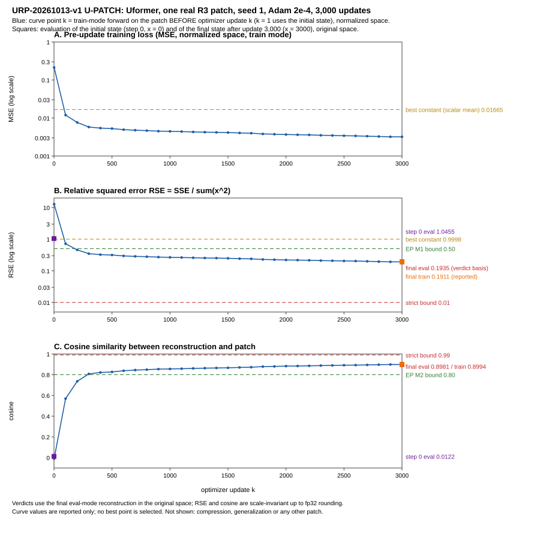

# URP-20261013-v1 result: the Uformer on one real LoRA-derived patch

The implementer wrote this report; it is not an independent acceptance. The approved package is `manifest_urp.json`,
SHA-256 `1df7af08c8b5897ad23fac88ab94e4ad36212a47cd542bb584e85ca07df91bd1` (16,432 bytes). All 61 entries and all 4
external bindings matched before the launch and again after the run.

## Question and answer

The question: can the frozen U-FIT Uformer learn to reconstruct one real 32 × 32 patch of the R3 snapshot under the
registered CPU budget?
- Model: 685,507 parameters, latent [64,32,32], a 64:1 element expansion.
- Patch: `Phi[0,1024:1056,768:800]` of t 7, client 91, the layer 12 q/k blocks.
- Budget: seed 1, Adam 2e-4, 3,000 updates.

| Criterion (final eval mode, original space) | Outcome |
|---|---|
| Strict near-identity: RSE ≤ 0.01 and cosine ≥ 0.99 | **COMPLETED_FIT_FAIL**: RSE 0.1935 is 19.3 times the bound; cosine 0.8981 is 0.0919 short |
| EP-20261012-v1, pre-specified for this run | **PASS**: V1, V2, M0, M1, M2 and M3 all hold |

Both outcomes stand. The final reconstruction removed 80.7% of the squared error of the best constant predictor, but
it is not near-identity.

## Execution (from the records, not from the exit code)

| Item | Verified value |
|---|---|
| Invocations / starts | 1 of 1 / 1 of 1: **the budget is consumed**. The primary ledger and the mirror are byte-identical (4 records) |
| Updates | 3,000 of 3,000 planned |
| Status | COMPLETED_FIT_FAIL in the child record, the end record, the invocation summary and `--status`; re-derived by the analyzer and independently |
| Guards | no guard action, no interruption, no stop request; child and supervisor stderr empty |
| Exit codes | status before 0, scientific 0, status after 0 |
| Binding | the input checks all held before the optimizer existed; initial state `7a36411bbfb83197a433ca23b099e9429dc5699fb5af765a1d6f1c2f5a35e6f7` equals the U-FIT record; all 7 imported module hashes equal the manifest; `cg_fedllm` was not imported |

| Timing scope | Seconds |
|---|---|
| Launch wrapper, from status before to status after (17:03:38.420–17:12:33.643 +08:00) | 535.223 |
| Scientific command, from process start to exit (17:03:41.913–17:12:30.548) | 528.635 |
| Supervisor aggregate, from import to the invocation summary (limit 7,200) | 528.281 |
| Arm, from just before the start record to the child's exit (limit 1,800) | 528.140 |
| Child process, from after its imports to its record | 525.593 |
| Training loop, curve point 1 to point 3,000: 0.174 s per update | 522.016 |
| Final state save, read-back and the two final evaluations | 0.890 |

Resources:
- **RSS.** Guard sampled maximum 823,758,848 B (1,930 samples at 0.25 s). The child sampled 828,366,848 B, and its OS
  peak working set was 828,628,992 B. The limit was 4,294,967,296 B, because 50% of the 9,453,146,112 B available at
  launch was above 4 GiB.
- **Retained evidence.** 6,416,844 B against a cap of 536,870,912 B.

## Final metrics

| | Eval mode (verdict basis) | Train mode (reported only) |
|---|---|---|
| RSE, original space | 0.19345271823265606 | 0.1911437869245869 |
| Cosine, original space | 0.8981045580444489 | 0.8993734990926799 |
| RSE / cosine, normalized space | 0.1934527170618834 / 0.8981045587115517 | 0.1911437841892307 / 0.899373500622392 |
| MSE, original space | 7.99371986840454e-07 | 7.898311800527734e-07 |
| Norm ratio / max abs error, original space | 0.8914325708689224 / 0.005559624172747135 | 0.8953142140820148 / 0.005500545725226402 |

- **Baselines, original space.** The values agree in four places: the task statement, `input_record.json`,
  `urp_config.json` and the child record. They were also recomputed from the patch bytes, with a difference of 0 ulp.
  - Zero prediction: 4.132131066150689e-06.
  - Scalar mean: 4.131472976536517e-06. This is the better of the two; it predicts one scalar, the patch mean
    −2.5653e-05.
  - Normalized space: 0.016654169372344353 and 0.016651517003540468.
- **EP checks.**
  - M1: RSE 0.1935 ≤ 0.50 (margin −0.3065).
  - M2: cosine 0.8981 ≥ 0.80 (margin +0.0981).
  - M3: MSE 7.99371986840454e-07 ≤ 3.305178381229214e-06, which is 0.80 times the scalar-mean MSE. MSE over the best
    baseline is 0.19348353272071525.
- **Step 0.** The initial state in eval mode had RSE 1.0455234343895818 and cosine 0.012247414211391543 (original
  space).

## Learning curve ([learning_curve_u_patch.svg](learning_curve_u_patch.svg), [curve_u_patch.csv](curve_u_patch.csv))

- **Timing.** Point k is the train-mode forward on the patch before update k, in normalized space, so point 1 is the
  initial state. Its gradient comes from update k, and its parameter change, time and RSS are taken after update k.
  The verdict is not read from the curve.
- **Shape.** All 31 points are finite, and the loss fell at every recorded point.
  - MSE: 0.2138 at update 1, 0.01192 at 100, 0.004448 at 1,000, 0.003673 at 2,000 and 0.003197 at 3,000.
  - Pre-update RSE: 12.84, 0.716, 0.267, 0.2206 and 0.1919 at the same points.
- **Diminishing, but not stopped.**
  - The loss ratio is 0.870 over the last 1,000 updates and 0.937 over the last 500.
  - Over the last 1,000 updates, the drop per 100 updates ranged from 0.14% to 2.2%. The smallest was the last
    interval, 2,900 to 3,000; one interval cannot separate a slowdown from fluctuation.
  - The log-log slope over updates 2,000 to 3,000 is −0.34.
  - These points cannot show whether the loss is near a floor, or that near-identity is reachable.
- **Gradients and parameters.**
  - Every parameter received a finite gradient at every point.
  - Group gradient norms fell 24 to 49 times between update 1 and update 3,000, not monotonically.
  - The parameters moved 3.0% to 5.2% from their initial values (relative L2 per group), and every element changed.

## Verification

- **Frozen `urp_analyze.py`** (exit 0, 17:36:42–17:36:44): evidence verified with no problems; strict status
  re-derived equal to the record; EP PASS.
  - `analysis/analysis.json`: 7,150 bytes, SHA-256
    `a4721424aaf4539daf55c8498344da6e0efbe2679c96d610780e2e0600722d5f` (file bytes, LF).
  - The sealed list holds 15 files, and every file now in the run root and the mirror is on it.
- **`independent_verify.py`** imports neither torch nor the analyzer; all of its checks hold.
  - Metrics recomputed from the recorded SSE, T, P, D and N equal the records bit for bit. Exact rationals agree to
    0 ulp, and SSE = P + T − 2D holds to within 1.9e-15.
  - A re-implementation of EP from `POLICY.md` gives PASS. The frozen classifier, applied to an input built
    independently, gives identical checks and quantities.
  - State files were parsed without torch. The state hashes recomputed from the bytes equal both the metadata and
    the records. Each file has 296 tensors. `num_batches_tracked` goes from 0 to 3,000, all values are finite, the
    running variances are ≥ 0 and the index buffers are unchanged.
- **Forward-only replay** (`replay_final_state.py`): the frozen loader built two fresh models, one per mode, with no
  optimizer and no gradient.
  - Every recorded sum is bit-identical in both modes and both spaces.
  - The eval copy's state was unchanged by its forward pass. The disposable train copy's BatchNorm buffers changed,
    as recorded. The run-root files are unchanged.
- **Read-back.** `urp_control.save_state` returns its record only after comparing the written file with the
  in-memory state bit for bit, and raises otherwise. Both records are present and the run completed, so both
  comparisons passed. This is inferred from the code path and the records.

## Interpretation and limits

- **Shown, narrowly.** Under these registered conditions, the trained Uformer's final eval-mode reconstruction of
  this one patch is clearly better than any constant: its MSE is 19.3% of the best constant's, with cosine 0.898.
- **Not shown.**
  - Near-identity.
  - Compression: the latent is a 64:1 expansion.
  - Generalization to other patches, snapshots or unseen data.
  - Whole-snapshot reconstruction: the patch is 1,024 of the 3,145,728 Phi elements.
  - Downstream benefit, or successful FAF.
  - Seed stability: one seed, one start.
- **The strict failure is bounded by the budget.** It does not show that the Uformer is generally incapable. The loss
  was still falling at update 3,000, and more updates were not tested.
- **BatchNorm.** Train and eval mode were almost the same: the output difference was 1.1% of the eval SSE. So the mode
  switch accounts for little of the remaining error here. This alone neither proves nor rules out a
  BatchNorm-related mechanism.
- **Context only.**
  - U-FIT on the synthetic input: 0.2727 / 0.8540; its EP PASS was post hoc.
  - R-FIT: 0.2243 / 0.8835.
  - The input and the normalization differ from this run, so these are not matched comparisons. Both historical
    strict failures, and R-FIT's better synthetic fit, are unchanged.

## Discrepancies and deviations

- **Scientific evidence: none found.** Every record, hash and metric agrees. The normalized and original RSE differ
  by a relative 6e-9; that is fp32 rounding in `denormalize`.
- **First replay attempt.** My replay script's first attempt exited 1 after its forward passes and wrote no record:
  its module filter accepted the relative pseudo-path `_classes.py`.
  - The output is kept as `replay_final_state.attempt1_failed.out.txt`, with
    `replay_final_state.attempt1_NOTE.txt`.
  - I changed the filter to the child's own rule, then re-hashed the run root against the sealed list: unchanged.
- **Figure.** I regenerated it once to fix overlapping labels, from the same data.
- **Launch method.** The `PROPOSED_LAUNCH.md` commands ran unchanged inside a detached PowerShell wrapper, so that a
  chat interruption could not stop the run or cause a second launch. This was recorded in `prelaunch_check.md`
  before the launch.

## Files (this directory)

- **Authorization and checks:** `EXECUTION_AUTHORIZATION.md`, `prelaunch_check.md`, `prelaunch_verify.py` and
  `prelaunch_verify.out.txt`, `process_detach_check.*`.
- **Launch:** `launch_scientific.ps1`, `launch/`.
- **Analysis:** `run_analyzer.ps1`, `urp_analyze.command.txt`, `urp_analyze.out.txt`, `urp_analyze.err.txt`,
  `analysis/`.
- **Independent checks:** `independent_verify.py`, `independent_verification.json`, `independent_verify.out.txt`;
  `replay_final_state.*`.
- **Curve:** `make_curve_figure.py`, `learning_curve_u_patch.svg`, `curve_u_patch.csv`.
- **Report check:** `verify_report_numbers.py` and `verify_report_numbers.out.txt` (0 problems).
- **Next steps:** `NEXT_EXPERIMENT_PROPOSAL.md`, `CONTINUATION_CHECKPOINT.md`.
- **Inventory:** `EVIDENCE_INVENTORY_SHA256.txt`, written last.
- **Elsewhere:** run root `D:/cgfed-runs/urp_20261013_v1/`; ledger mirror
  `diagnostics/urp_20261013_v1/scientific_ledger_mirror/`.
